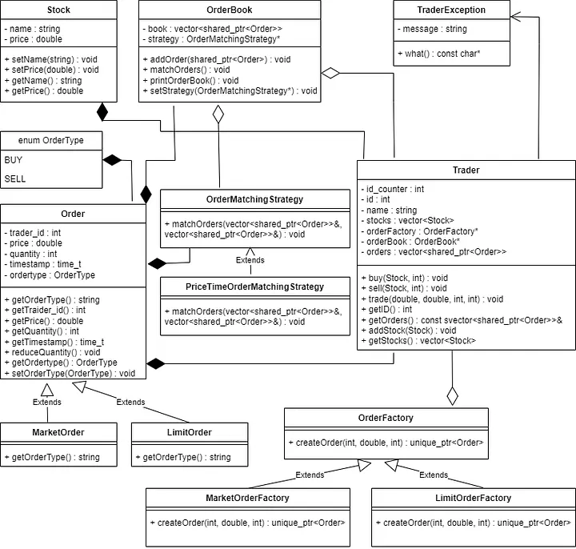

# stockapp

# Stock Trading System
 
## Introduction
 
The Stock Trading System project is a C++ application that simulates a stock trading environment. This README provides an overview of the project structure, design, and implementation approach used in building it.

## testing

tests.cpp has 24 tests utilizing the order, the order boook and the engine

// Unit tests for the order book and engine. No external framework needed.
//

Build:  g++ -std=c++17 -Wall -Wextra -pthread tests.cpp Order.cpp OrderBook.cpp Engine.cpp -o tests

Run:    .\tests        (exit code 0 = all passed)